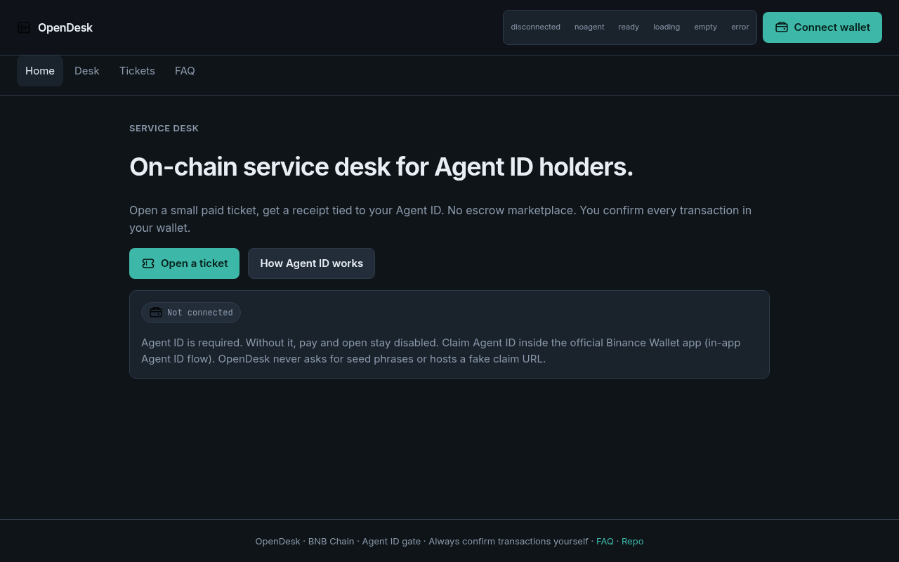
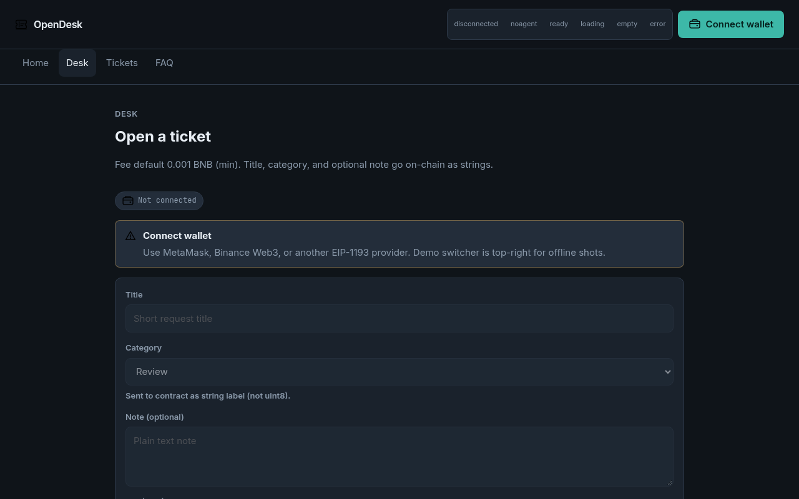
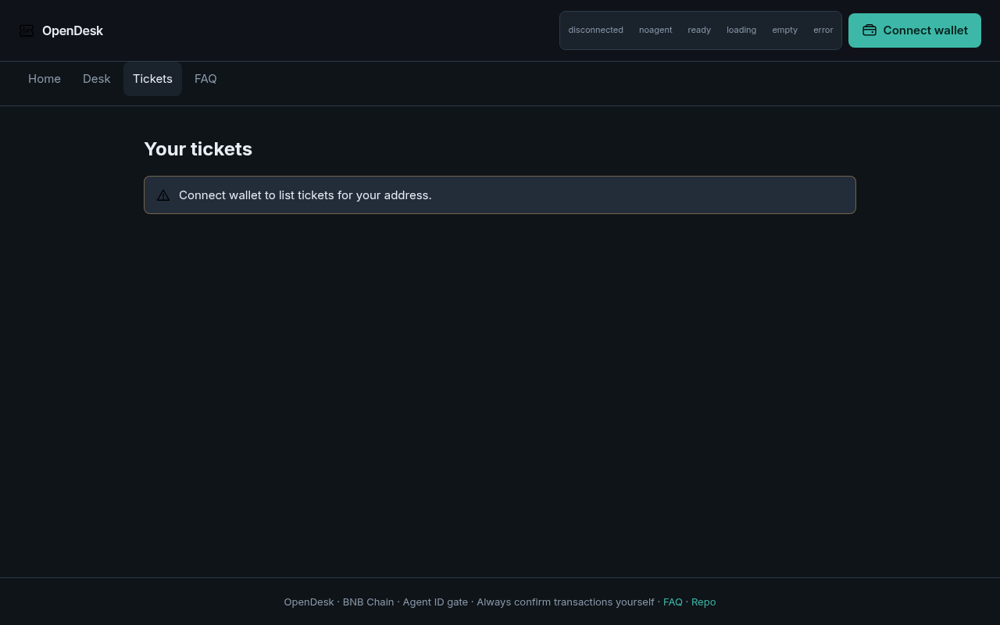
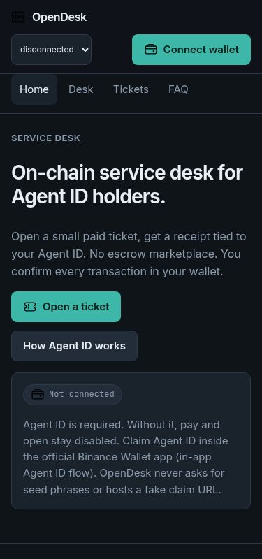

# OpenDesk

On-chain service desk for Binance Agent ID holders on BNB Chain.

## Links

- [Live app](https://opendesk-dc5.pages.dev)
- [Demo (ready state)](https://opendesk-dc5.pages.dev/?demo=ready)
- [Demo video](https://opendesk-dc5.pages.dev/demo/)
- [Verified contract](https://bscscan.com/address/0x92D3290E4bB04E32D321d58A5bB1a77E049F2e93#code). Source verified on BscScan, Solidity 0.8.24.

## How it works

1. Connect a wallet (MetaMask, Binance Web3 Wallet, or another EIP-1193 provider). You confirm every transaction yourself. Nothing is auto-signed.
2. The app checks `balanceOf` on the Agent ID registry (`0x60b9262456de011f7d15a54cdd8c48baaa8b022f`). If that balance is 0, pay stays disabled. Claim an Agent ID only inside the official Binance app.
3. Open a ticket with a title, category, optional note, and a fee of at least minFee (**0.001 BNB**). The contract has no maxFee. The fee is held in the contract, and `TicketOpened` is the receipt (`ticketId`, agent address, fee, timestamp, status `open`).
4. The fixed operator calls `resolveTicket(uint256 ticketId)`. On resolve, the held fee is sent to the immutable treasury. While the ticket is still `open`, `cancelTicket` refunds the fee in full. After resolve, the fee is non-refundable.

The owner can only `pause` and `unpause` new tickets. Treasury, operator, and the registry address are fixed at deploy. No mint, no dynamic tax, and no user freeze.

## Screenshots

  
  

## Stack

- Solidity 0.8.24 and Foundry (`OpenDesk.sol`)
- `viem` on a static site hosted on Cloudflare Pages
- No backend that holds keys

## Safety rules we follow

- Every on-chain action needs the user's own wallet confirmation.
- No QR pairing of Agentic Wallet on our site.
- No unlimited ERC-20 approve (we take native BNB only).
- Neutral name and brand (OpenDesk). We do not imitate Binance or BNB visual identity.
- No seed phrases, no "pay gas to claim a prize" flows.

## Deployment

| Field | Value |
|---|---|
| Live URL | `https://opendesk-dc5.pages.dev` |
| Repo | `https://github.com/eunseoxz/opendesk` |
| Contract | `0x92D3290E4bB04E32D321d58A5bB1a77E049F2e93` · https://bscscan.com/address/0x92D3290E4bB04E32D321d58A5bB1a77E049F2e93 |
| Deploy gas (measured) | `deploy gasUsed 1,124,223 (tx 0xc30e2bfe…c0be, BSC mainnet)` |
